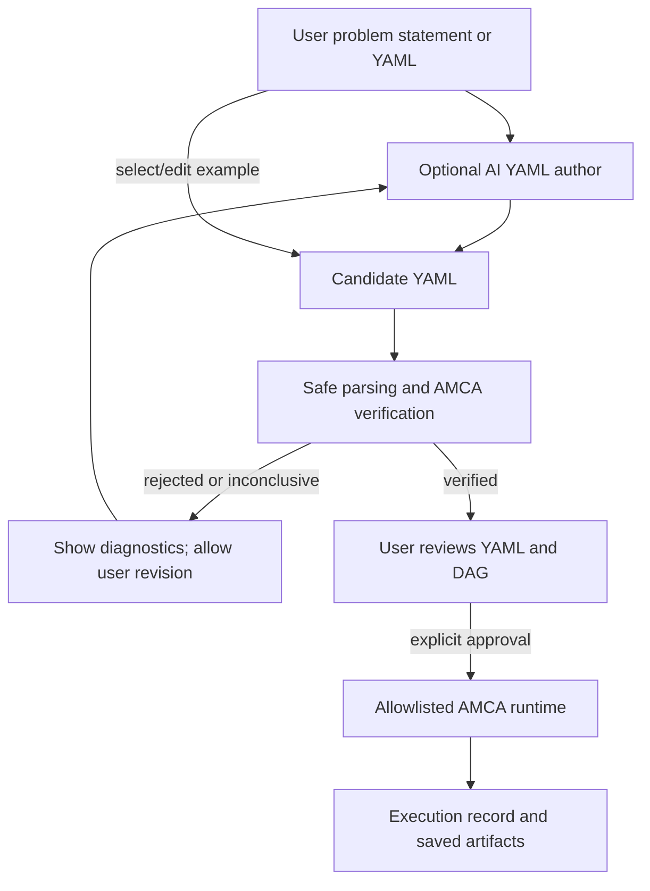

# Almudaya Machine Construction Agent (AMCA)

AMCA is a research PoC for describing, checking, and executing small computational machines assembled from registered components. It explores one practical slice of the vision in the AMCA white paper: treating a machine as a declarative, composable graph that can be inspected and checked before execution.

> **Research status:** The white paper presents a conceptual framework and research agenda, not a completed formal theory or experimentally validated general-purpose machine-construction system. This repository implements a bounded PoC. Its results should not be read as proof that the broader theory has been established.

## The idea behind AMCA

The white paper proposes that a computational machine can be treated as a constructible object. A machine description can specify components and how their inputs and outputs connect; construction mechanisms can compose or transform descriptions; verification can check a candidate before it runs. It distinguishes the machine description from the executable implementation, and construction from ordinary computation.

The PoC turns part of that idea into an engineering workflow:

1. A user supplies a declarative machine description in YAML—or, in the optional web interface, gives a problem statement and asks an AI model to propose YAML.
2. AMCA parses the YAML as untrusted data and builds a normalized candidate DAG from known components.
3. The verifier checks the graph and declared component interfaces.
4. Only a candidate with a current `verified` result can be offered to the runtime. The web UI also requires the user to approve that run.
5. The runtime dispatches the registered component functions in deterministic dependency order and produces an execution record.
6. The YAML, graph, verification result, and execution result can be inspected as artifacts.



## What “machine construction” means in this PoC

The current machine is a **DAG specification executed by the existing AMCA runtime**. The constructor normalizes a valid YAML description into a candidate graph. It does not compile or generate a new engine, write component code, or create a persistent autonomous agent.

The optional agent UI can propose that graph description from a natural-language request, and the user can request YAML revisions in the same chat session. The model is constrained by a prompt to use AMCA's current schema and component allowlist. Its output is still an untrusted candidate: AMCA validation is authoritative, and the model cannot add executable components. AI generation is stochastic and may be invalid or may not satisfy the user's intent.

The reference graph is:

```text
Input → Validate → Analysis A ─┐
                    Analysis B ─┴→ Aggregate → Report
```

Analysis A and Analysis B form a branch that rejoins at Aggregate. This is a nonlinear graph topology in the sense of branching dependencies. The runtime currently executes ready nodes sequentially in a deterministic order; it does not run the branches physically in parallel. There are no conditional transitions or runtime graph transformations.

## White-paper ideas mapped to the implementation

The statuses below describe the project implementation and evidence, not the truth or validity of the white paper's broader research hypotheses.

| White-paper concept | What this PoC does | Status and boundary |
|---|---|---|
| Machines represented as constructible objects (Sections 3.1–3.2) | Represents a machine as YAML, then normalizes it into a candidate graph with canonical hashes. | **Partially demonstrated.** YAML and the candidate graph are explicit artifacts; the paper's general machine object and construction algebra are not formalized here. |
| Composition into computational graphs (Section 3.3) | Composes six registered component instances through typed input/output edges. | **Demonstrated for the reference graph and supported contracts.** This is a finite DAG class, not a universal architecture representation. |
| Linear and nonlinear architecture | Supports linear paths and branch/join topology. | **Partially demonstrated.** The reference includes one branch/join; no conditional control flow, hypergraphs, shared memory, or dynamic topology. Branches execute sequentially. |
| Construction agent and scaffold (Section 7) | Uses a fixed component registry and validator. The optional web layer can ask a model to draft/revise YAML from a user problem statement. | **Partially implemented.** The original CLI expects user-authored YAML. AI generation is an optional authoring aid, not a general machine synthesizer; live provider generation has not yet been verified in the extension review. |
| Deductive construction (Section 5.1) | Applies a fixed schema, component contracts, and deterministic normalization. | **Partially demonstrated.** There are no general construction operators or proof that a candidate satisfies arbitrary user goals. |
| Probabilistic synthesis and candidate ranking (Sections 5.2–5.3) | An external model may produce a YAML candidate, and the user may ask for revisions. | **Not demonstrated as the paper's probabilistic synthesis.** There is no defined candidate distribution, multi-candidate search/ranking, or measurement of candidate diversity or success. |
| Independent verification (Section 6.1) | A verifier module checks graph shape, IDs, bounds, registered components, endpoints, interfaces, required inputs, acyclicity, and registry binding. The runtime rechecks verification evidence before dispatch. | **Partially demonstrated.** Checks are separate from construction and execution in software modules, but run in the same application/process. `verified` means only that the defined checks passed; it is not a formal proof or independent external audit. |
| Hoare-style/compositional correctness (Section 6.2) | No pre/postcondition calculus is implemented. | **Not implemented.** The verifier does not prove that component semantics compose to satisfy a requested behavior. |
| Graph/hypergraph behavioral semantics (Section 6.3) | Uses a finite directed graph with port-level edges and declared port types. | **Partially demonstrated.** Behavioral semantics, hyperedges, concurrency, and equivalence between machines are not defined. |
| Verification profiles and probabilistic properties (Sections 6.4–6.5) | Uses a fixed verifier profile with `verified`, `rejected`, and `inconclusive` outcomes. | **Partially demonstrated.** There are no selectable formal profiles or probabilistic verification claims. |
| Meta-machines and recursive construction (Section 4; Experiment E3) | None. A pipeline may emit a report, but it does not construct another machine. | **Not implemented or evaluated.** No recursive constructor, meta-machine, construction-depth model, or self-construction capability. |
| Dynamic architecture transformation and invariant preservation (Section 4.3; Experiment E5) | None. The graph is fixed for a run. | **Not implemented or evaluated.** No graph mutation or invariant-preservation proof/measurement. |
| NUTM / nondeterministic computation as inspiration (Sections 2.1 and 9.6) | No NUTM or nondeterministic runtime is implemented. | **Conceptual context only.** The paper itself treats NUTM as inspiration and says branching computation does not automatically imply machine synthesis. |
| Evidence and operational evaluation (Sections 7–8) | Saves candidate hashes, verification checks, deterministic execution order, per-node status, and output summaries. | **Demonstrated for the bounded runtime.** No evaluation yet of general construction accuracy, success rate from problem statements, revision cost, candidate diversity, performance, or scalability. |

### Proposed architecture subsystems (white paper Section 7.2)

| Proposed subsystem | AMCA counterpart | Coverage |
|---|---|---|
| Specification Interpreter | Natural-language problem statement is sent to the selected model together with the current YAML and recent chat. | **Partial.** No separate parser that extracts a formal requirement set, constraints, and acceptance criteria. |
| Construction Agent | Optional provider adapter proposes YAML and can revise it from user chat requests. | **Partial, not yet evaluated with a live provider.** It is an authoring assistant, not an open-ended architecture synthesizer. |
| Construction Scaffold | Strict YAML schema, fixed six-component allowlist, port contracts, and graph constraints. | **Demonstrated within the fixed registry.** It cannot load arbitrary plugins or components. |
| Architecture Builder | `constructor.py` normalizes a validated specification into a candidate graph. | **Partial.** It does not discover or compose components from an abstract goal on its own. |
| External Verification System | `verifier.py` applies a fixed set of structural, interface, and acyclicity checks. | **Partial.** It runs in the same local application/process and does not prove behavioral properties. |
| Revision Mechanism | User can ask for YAML revisions through chat and sees AMCA validation findings. | **Partial.** Validator feedback is not automatically sent to the model as a repair cycle; the user must request and guide the revision. |
| Runtime and Orchestrator | `runtime.py` executes verified graphs through the built-in registry in stable dependency order. | **Demonstrated for supported components.** Sequential local execution only; no physical branch parallelism or long-running agent. |
| Evidence and Logging System | JSON reports and local YAML, candidate graph, DAG source, and run records. | **Demonstrated for exercised local runs.** Not an immutable or tamper-proof audit log. |

### Proposed experiments and evaluation metrics

| White-paper experiment/metric | Current evidence | Remaining work |
|---|---|---|
| E1 — Linear construction | Linear dependency paths are representable and can run from a supplied YAML. | Demonstrate generation from a problem specification; define success criteria and measure success rate. |
| E2 — Nonlinear construction | Reference YAML contains the required branch/join structure; verifier checks dependencies and typed ports. | Show the agent can reliably create such graphs from goals. Physical parallel execution and synchronization are not implemented. |
| E3 — Meta-machine construction | No evidence. | Define and implement bounded recursive construction, then test M0→M1→M2 cases. |
| E4 — Probabilistic synthesis | The optional model API may return a candidate YAML, but generation has not been tested in this review. | Generate multiple candidates, define ranking/selection criteria, and measure diversity and success. |
| E5 — Dynamic transformation | No graph transformations are supported. | Define permitted changes and invariants, then prove or measure invariant preservation. |
| Structural validity and contract satisfaction rates | The baseline verifier test set checks supported structural/interface cases. | Measure these rates over a defined set of AI-generated candidates; the post-extension suite is still pending. |
| Construction success, revision count, and cost | No empirical measurements. | Run controlled tasks and record acceptance against user criteria, iterations, elapsed time, and resources. |
| Meta-construction success, invariant preservation, candidate diversity | No empirical measurements. | Requires E3–E5 plus precise definitions for candidate equivalence, invariants, and resource bounds. |

### Short answer to “what does the agent produce?”

In the current web extension, the agent's direct output is **a proposed YAML machine specification**. After validation and user approval, the existing AMCA runtime executes that specification as a DAG over built-in components. The produced artifacts include the YAML, normalized candidate graph, DAG visualization source, verification report, and—after execution—an execution record. It does not produce a new runtime engine or a standalone agent program.

## Current component allowlist

Only these project-owned components can execute:

| Component | Function |
|---|---|
| `input_source` | Reads one named string value from the run's JSON input. |
| `validate_text` | Rejects empty/whitespace-only text and returns normalized text. |
| `analysis_a` | Reports character count. |
| `analysis_b` | Reports word count. |
| `aggregate_results` | Combines the two findings into a summary string. |
| `generate_report` | Wraps the summary in a report object. |

Machine YAML cannot import modules, run shell commands, provide Python source, or register new components. Component code is trusted in-process Python, however; this is not an operating-system sandbox or security certification.

## Running AMCA

### CLI PoC

Requires CPython 3.12+ and the base dependencies. From the repository root in PowerShell:

```powershell
py -3.12 -m venv .venv
$Python = ".\.venv\Scripts\python.exe"
if (-not (Test-Path $Python)) { throw "Virtual environment not found. Run: py -3.12 -m venv .venv" }
& $Python -m pip install -r requirements-dev.txt
$env:PYTHONPATH = "src"

# Validate or verify without running the machine
& $Python -m amca.cli validate examples/valid_parallel_analysis.yaml
& $Python -m amca.cli verify examples/valid_parallel_analysis.yaml

# Run the reference graph and save its JSON execution record
& $Python -m amca.cli run examples/valid_parallel_analysis.yaml `
    --inputs examples/reference-input.json --output run.json
& $Python -m amca.cli report run.json
```

The sample input `AMCA builds a graph.` produces `characters=20; words=4`. The negative example `examples/invalid_missing_dependency.yaml` is missing an Aggregate dependency and should be rejected before any component executes.

### Optional web interface

The web UI adds Streamlit while keeping it out of the CLI's base dependency set:

```powershell
py -3.12 -m venv .venv
$Python = ".\.venv\Scripts\python.exe"
if (-not (Test-Path $Python)) { throw "Virtual environment not found. Run: py -3.12 -m venv .venv" }
& $Python -m pip install -r requirements-app.txt
$env:PYTHONPATH = "src"
& $Python -m streamlit run app.py
```

Open [http://localhost:8501](http://localhost:8501). Choose an example YAML or write a problem statement. To generate/revise YAML, select a provider and enter its API key in the sidebar. The statement, recent chat, and current YAML are sent to that provider; do not submit information you do not want to transmit. The API key is kept in the active UI session and is not written to AMCA artifacts.

Review the returned YAML and validation findings. Request refinements through the chat field; each response is saved as a new YAML version. Once the verifier returns `verified`, inspect the DAG and enter runtime JSON input. The web interface requires an explicit confirmation checkbox before it calls the runtime.

When the provider is not configured, example selection, YAML editing, local validation, graph rendering, and local execution remain available. The web service is intended for local single-user use. Authentication and remote deployment are not included.

## Artifacts

The CLI writes a JSON run record when `--output` is specified. The web interface saves run folders under `artifacts/runs/` and chat sessions under `artifacts/agent_sessions/`.

Typical run artifacts:

| File | Contents |
|---|---|
| `machine.yaml` | The candidate specification used for that cycle. |
| `candidate-graph.json` | Normalized graph and graph/specification hashes. |
| `machine-dag.dot` | Graphviz source for the DAG. |
| `verification-report.json` | Check outcomes and any rejection reasons. |
| `execution-record.json` | Runtime status and per-node execution evidence; only present after a run. |
| `manifest.json` | Run identifier, status, and timestamp. |

The UI can display and download run artifacts and reload locally saved chat sessions/versions. Chat text and YAML are stored on the local machine, so treat that folder as user data. API keys are excluded.

## User documentation

Detailed Indonesian manuals are in [`help/`](help/): [User Manual](help/USER-MANUAL.md), [User Guide](help/USER-GUIDE.md), and [User Tutorial](help/USER-TUTORIAL.md). The optional agent CLI (`python -m amca_agent.cli`) provides example selection, AI authoring and chat revisions, validation, DAG export, saved-session loading, and artifact inspection. Its `chat` workflow asks for explicit `RUN` approval, while its noninteractive `run` command does not prompt. PowerShell scripts for common GUI/CLI workflows are in [`help/scripts/`](help/scripts/).

## Limitations and safety boundaries

- The reference implementation is a fixed component graph class with six trusted built-ins. It does not generate new executable component implementations.
- AI authoring is optional, provider-dependent, stochastic, and currently awaits extension-specific verification. Successful model output does not establish that the YAML matches the user's intent.
- Structural verification checks declared contracts and graph properties. It does not prove semantic correctness of components, universal runtime behavior, or fulfillment of natural-language goals.
- `verified` means every applicable check in the current verifier profile passed. It does not mean mathematically proven, certified secure, or production ready.
- The DAG scheduler is deterministic and sequential. The reference branches do not execute concurrently.
- There is no recursive or meta-machine construction, probabilistic candidate search/ranking, dynamic graph rewriting, invariant-preservation proof, or NUTM implementation.
- No benchmarks or broad experiments establish speed, scalability, construction success rate, or reliability on arbitrary tasks.
- The optional AI UI sends problem/chat/specification data to the selected external provider when generation is requested. Validation and machine execution stay local.
- The UI's local artifacts are not encrypted or multi-user protected. The runtime uses trusted Python functions in-process and is not an OS-level sandbox.

## Project status and evidence

The repository implements **AMCA Local Independent Version (`v0.2.0`)**, including the baseline deterministic DAG verifier/runtime (`P0`–`P6`), the web/CLI authoring interface (`CR-001`), and the refactored **Specialized Agent Harness, 3-Stage Compositional Formal Verifier, and Bounded Project Constructor (`CR-002`)**:

- **12-Provider Specialized Agent Harness (`src/amca_agent/harness.py` & `provider.py`)**: Supports hot-swappable Cloud API keys (`Gemini`, `xAI (Grok)`, `OpenAI`, `Anthropic`, `Custom OpenAI-Compatible`), **`9Router` (`http://127.0.0.1:20128/v1` including 9Router Combos)**, local AI runtimes (**`Ollama`**, **`LM Studio`**, **`OpenCode`**), hardware-gated **`Local Model`** downloads (`src/amca_agent/hardware.py`), **`AMCA Combo`** token-limit fallback chains (`Tier 1 -> Tier 2 -> ... -> Tier N`), and **`Offline Deterministic`** synthesis.
- **On-The-Fly Subworker HITL**: Prompts human approval and dedicated API key/model binding whenever a Subworker is proposed.
- **3-Stage Compositional Formal Verification (`src/amca_agent/formal_verifier.py`)**: Proves Stage 1 spec obligations (`FO-TOP-01` reachability, `FO-CON-01` Church-Rosser confluence, `FO-HOA-01` Hoare pre/postcondition entailment, `FO-GOAL-01` goal entailment, `FO-SEC-01` secret taint non-interference), Stage 2 revision invariant preservation (`FO-EVO-01`), and Stage 3 post-construction Python `ast.parse()` graph isomorphism ($G_{\text{code}} \cong G_{\text{yaml}}$, `FO-REF-01` & `FO-REF-02`).
- **Bounded Project Builder & Handover ZIP (`src/amca_agent/builder.py` & `packager.py`)**: Generates a standalone runnable Python project in `artifacts/constructed_projects/<machine_id>-rev<NNN>/`, runs bytecode compilation and generated unit tests, and packages `<machine_id>-rev<NNN>-handover.zip`.

Key documentation and verification evidence:
- [P6 baseline evaluation and handover](docs/10-release-and-evaluation.md)
- [CR-001 agent/web extension review and evidence](docs/11-agent-web-extension-review.md)
- [CR-002 agent constructor requirements](docs/12-agent-constructor-requirements.md)
- [CR-002 agent constructor architecture](docs/13-agent-constructor-architecture.md)
- [CR-002 verification and handover report](docs/14-agent-constructor-verification-and-handover.md)
- [Requirements-to-test traceability](docs/traceability-matrix.md)
- [Workflow and approval records](workflow/gate-records.yaml)
- [User Manual](help/USER_MANUAL.md) · [User Guide](help/USER_GUIDE.md) · [User Tutorial](help/USER_TUTORIAL.md)

The white paper's research questions and proposed experiments remain a research agenda. See Sections 8–12 of the manuscript for proposed metrics, experiments, and unresolved formalization questions. The white paper states that the general framework is preliminary and does not claim an experimentally validated system; this implementation likewise makes only the bounded claims supported by its code and evidence.

The manuscript file itself is not included in this repository; the section references above refer to the separately supplied project white paper.
