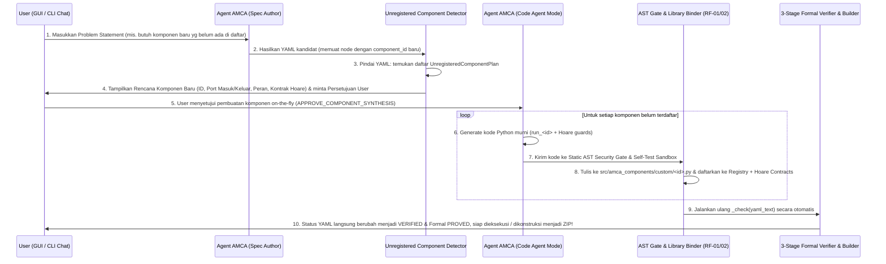

# Fase RF-03: Sintesis Kode Komponen *On-The-Fly* di Tengah Alur Chat $\rightarrow$ YAML $\rightarrow$ Konstruksi (`src/amca_agent/component_synthesizer.py`)

## 1. Tujuan Teknis (Poin 1)

Meletakkan kemampuan pembuatan komponen baru secara **otomatis dan dinamis di tengah alur kerja utama**:
1. Ketika user memasukkan *problem statement* ke dalam chat Agent AMCA, Agent AMCA menganalisis kebutuhan dan membuat spesifikasi YAML yang **boleh memuat rencana komponen baru meskipun belum ada di dalam daftar komponen terdaftar**.
2. Sistem mendeteksi komponen-komponen yang belum terdaftar di dalam YAML kandidat dan menampilkan rencana komponen tersebut kepada user untuk meminta **persetujuan (*Human-in-the-Loop*)**.
3. Setelah disetujui user, **Agent AMCA bertindak sebagai *Code Agent*** (menggunakan model AI aktif pada Harness/Combo/9Router/Ollama/OpenCode atau *Subworker* kode, dengan fallback synthesizer kode Python deterministik jika sedang offline) yang **mengenerate kode Python nyata secara *on-the-fly* untuk seluruh komponen tak terdaftar**, memverifikasi AST & kontrak Hoare-nya, **mendaftarkannya ke dalam Library Komponen (`src/amca_components/`)**, lalu **menggunakannya untuk memverifikasi YAML dan membangun kode mesin nyata / pipeline mesin (`.zip`)**.

---

## 2. Alur Sekuensial Rinci (Step-by-Step State Machine)



---

## 3. Desain Modul Baru `src/amca_agent/component_synthesizer.py`

### 3.1 Struktur Data `UnregisteredComponentPlan`
Ketika YAML kandidat yang dihasilkan oleh Agent AMCA (atau diedit oleh user) gagal divalidasi karena terdapat komponen yang belum terdaftar di `amca.registry.component_ids()`, fungsi `detect_unregistered_components_in_yaml(yaml_text: str, problem_statement: str = "") -> list[UnregisteredComponentPlan]` akan mem-parsing YAML mentah menggunakan `_StrictSafeLoader` dan mengekstrak seluruh node yang `component`-nya belum terdaftar:

```python
@dataclass(frozen=True)
class UnregisteredComponentPlan:
    component_id: str
    alias: str
    used_by_node_ids: tuple[str, ...]
    inferred_input_ports: dict[str, str]
    inferred_output_ports: dict[str, str]
    inferred_config_keys: tuple[str, ...]
    inferred_preconditions: dict[str, tuple[str, ...]]
    inferred_postconditions: dict[str, tuple[str, ...]]
    role_description: str
    upstream_components: tuple[str, ...]
    downstream_components: tuple[str, ...]
```

#### Bagaimana `detect_unregistered_components_in_yaml` Menyimpulkan Port & Kontrak Hoare Secara Presisi dari Graf `edges` YAML?
Ini adalah bagian paling cerdas dan deterministik dari arsitektur ini:
1. Dari daftar `edges` (atau `connections` pada `v1alpha1`) di dalam YAML:
   - Setiap edge `{from: u, out: p_out, to: v, in: p_in}` yang menuju ke node komponen baru `v` memberi tahu kita **nama port masuk `p_in`** dan **komponen hulu `u`**!
   - Setiap edge `{from: v, out: p_out, to: w, in: p_in}` yang keluar dari node komponen baru `v` memberi tahu kita **nama port keluar `p_out`** dan **komponen hilir `w`**!
2. Dari komponen hulu `u` dan komponen hilir `w`:
   - Jika komponen hulu `u` menghasilkan port bertipe `"string"` dengan pascakondisi Hoare $Q_u(\text{out})$ (mis. `validate_text` menghasilkan `{"is_str", "non_empty_raw", "non_empty_trimmed", "len_ge_1"}`), maka prasyarat Hoare $P_v(\text{in})$ otomatis diselaraskan dengan $\subseteq Q_u(\text{out})$ (mis. `{"is_str", "non_empty_trimmed"}`)!
   - Jika komponen hilir `w` membutuhkan prasyarat Hoare $P_w(\text{in})$ pada port bertipe `"string"` atau `"object"` (mis. `aggregate_results` membutuhkan `{"is_obj", "has_nonneg_int:character_count"}` atau `generate_report` membutuhkan `{"is_str", "formatted_metrics_summary"}`), maka pascakondisi Hoare $Q_v(\text{out})$ otomatis disetel agar memenuhi $\supseteq P_w(\text{in})$!
   - Dengan algoritma **Bidirectional Hoare Constraint Propagation** ini, komponen yang di-generate secara *on-the-fly* **dijamin 100% klop secara matematis** dengan tetangga hulu dan hilirnya pada saat pembuktian formal `FO-HOA-01` dan `FO-GOAL-01`!

---

### 3.2 Prompt & Eksekusi *Code Agent* (`synthesize_component_python_code`)

Ketika user menyetujui pembuatan komponen di dalam `list[UnregisteredComponentPlan]`, fungsi `synthesize_and_bind_missing_components()` menjalankan langkah berikut untuk setiap `plan`:

1. **Mode 1 — Sintesis Kode melalui Model AI Aktif di Agent Harness (`CODE_AGENT_SYSTEM_PROMPT`)**:
   Jika provider aktif adalah LLM nyata (**Gemini**, **9Router**, **Ollama**, **LM Studio**, **OpenCode**, **OpenAI**, **Anthropic**, atau **AMCA Combo**):
   - Agent AMCA memanggil LLM dengan `CODE_AGENT_SYSTEM_PROMPT` yang meminta **hanya 1 blok kode Python murni** berisi `AMCA_COMPONENT_META` dan fungsi `def run_<component_id>(inputs: dict[str, Any], config: dict[str, Any], raw_inputs: dict[str, Any]) -> dict[str, Any]:` yang:
     - Mematuhi `inferred_input_ports`, `inferred_output_ports`, `inferred_config_keys`,
     - Memanggil `_enforce_preconditions("<component_id>", inputs)` di awal dan `_enforce_postconditions("<component_id>", outputs)` di akhir,
     - Mengimplementasikan logika sesuai `problem_statement` dan `plan.component_id` hanya dengan modul standar aman (`re`, `math`, `statistics`, `collections`, `json`, `string`, `unicodedata`, `hashlib`), tanpa akses jaringan/OS.
2. **Mode 2 — Sintesis Kode Deterministik Lokal (Tanpa API Key / Fallback Otomatis)**:
   Jika provider adalah `Offline Deterministic` / `Local Model` (atau jika kode dari LLM gagal melewati *Static AST Security Gate* setelah 1 kali *auto-repair*), synthesizer otomatis mengonstruksi kode Python nyata berdasarkan analisis semantik `component_id`, `role_description`, dan tipe port (`inferred_input_ports` $\rightarrow$ `inferred_output_ports`).
3. **Verifikasi & Pengikatan ke Library (`bind_component_from_python_source`)**:
   - Kode Python yang dihasilkan langsung dimasukkan ke fungsi `bind_component_from_python_source()` (Fase RF-02):
     - Diperiksa oleh **Static AST Security Gate** (`audit_component_source_ast`),
     - Diuji di **Self-Test Execution Sandbox** (`verify_component_behavior`),
     - Ditulis sebagai modul permanen di `src/amca_components/custom/<component_id>.py`,
     - Didaftarkan ke `amca.registry`, `amca_agent.system_spec`, dan `amca_agent.formal_verifier.HOARE_CONTRACTS`.

---

## 4. Pembaruan pada `src/amca_agent/provider.py`

Agar Agent AMCA tahu bahwa ia kini boleh merencanakan komponen baru jika kebutuhan user belum tercakup oleh komponen yang sudah ada di katalog:
1. Perbarui `build_dynamic_system_prompt()` di `src/amca_agent/provider.py`:
   - Instruksikan bahwa model **mengutamakan penggunaan komponen yang sudah terdaftar di Katalog Komponen Terdaftar** (6 komponen bawaan + komponen kustom di library).
   - **NAMUN**, apabila permintaan user secara spesifik membutuhkan langkah pemrosesan/analisis baru yang belum tersedia di katalog (atau user meminta pembuatan komponen baru di dalam pipeline), model **diizinkan** menambahkan node dengan `component: "<new_component_id>"` (mengikuti pola identifier `^[a-z][a-z0-9_-]{0,63}$`) dan menghubungkannya secara rapi di `edges` setelah `validate_text`!
2. Perbarui `synthesize_deterministic_yaml()` di `src/amca_agent/provider.py`:
   - Jika di dalam prompt user meminta komponen baru yang belum terdaftar (misalnya menyebutkan nama komponen `component: <nama_baru>` atau meminta fitur spesifik seperti penghapusan HTML `html_cleaner`, analisis sentimen `sentiment_analyzer`, ekstraksi email `email_extractor`, dll.), synthesizer menyusun YAML yang memuat node komponen baru tersebut sehingga alur *On-The-Fly Component Synthesis* dapat bekerja baik dengan LLM maupun dalam mode *Offline Deterministic*!

---

## 5. Kriteria Lulus Fase RF-03 (*Verification Gate RF-03*)

1. Ketika diberikan YAML yang memiliki 1 atau lebih komponen yang belum terdaftar (mis. `html_tag_stripper` dan `sentence_length_scorer`), `detect_unregistered_components_in_yaml()` berhasil mendeteksi keduanya beserta port masuk/keluar dan kontrak Hoare yang klop dengan graf `edges`.
2. Ketika user memberikan persetujuan (`APPROVE_COMPONENT_SYNTHESIS`), `synthesize_and_bind_missing_components()` menghasilkan file `.py` nyata di `src/amca_components/custom/`, meluluskan audit AST & sandbox test, mendaftarkannya ke registry, dan ketika `_check(yaml_text)` dijalankan ulang, YAML tersebut langsung berstatus **`verified`** dan **`PROVED`**!
3. Ketika proyek tersebut dikonstruksi (`build_constructed_project` + `verify_and_package_project`), proyek lulus **Stage 3 AST Proof (`PROVED`)**, lulus `unittest`, dan menghasilkan paket `.zip` siap unduh.
